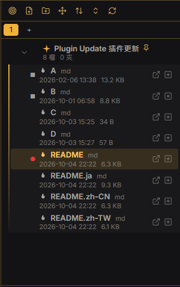
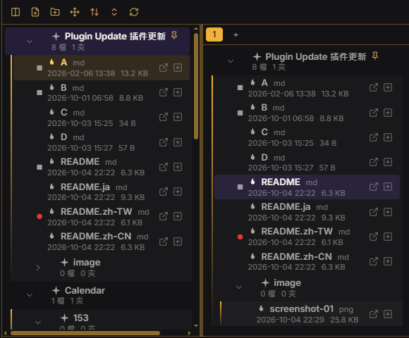
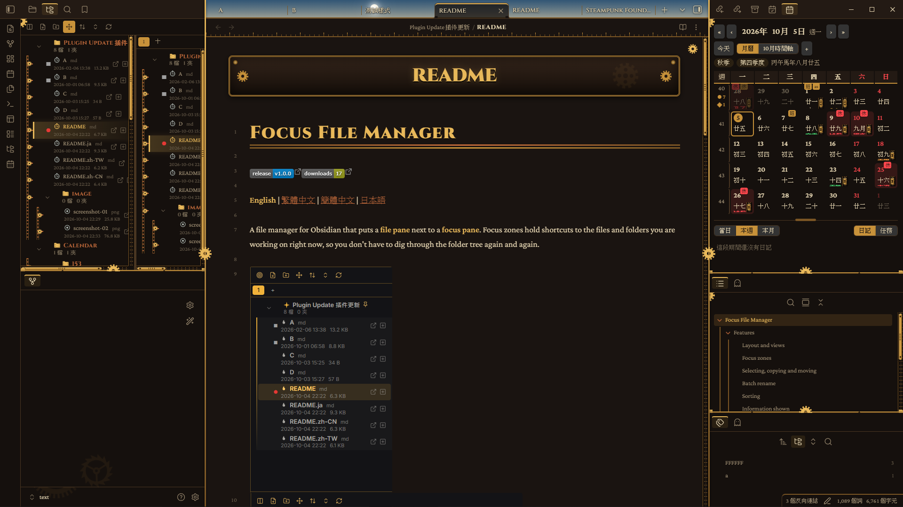
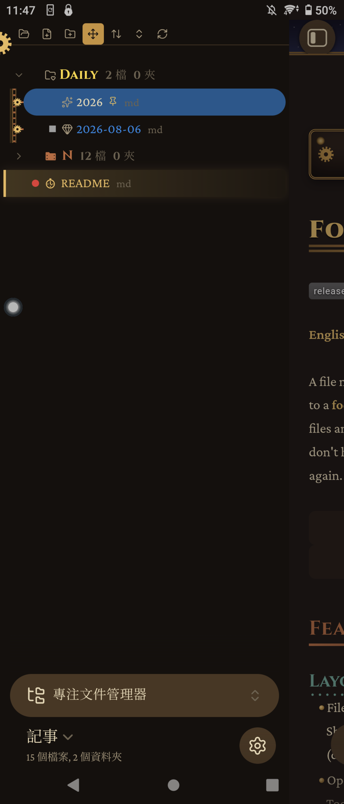
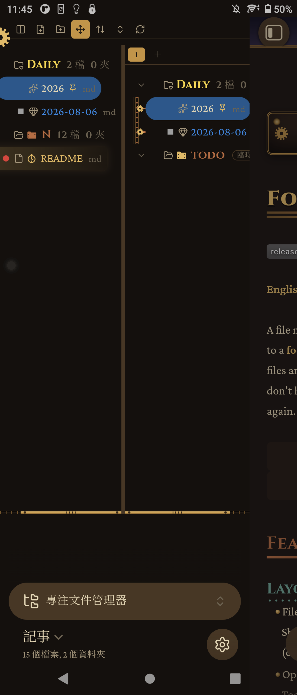

# Focus File Manager

[English](README.md) | [繁體中文](README.zh-TW.md) | [簡體中文](README.zh-CN.md) | **日本語**

Obsidian 用のファイル管理プラグインです。左に**ファイル管理ペイン**、右に**フォーカスペイン**を並べて表示します。フォーカスゾーンには、今まさに作業しているファイルやフォルダへのショートカットを置けるので、フォルダツリーを何度もたどる必要がありません。2.0.0 からは、左側を**タグ管理**と**プロパティ管理**に切り替えて、保管庫全体のタグとプロパティを整理することもできます。

  
  

  
  

## 更新履歴

### 2.1.0

このバージョンでは、一括名前変更を作り直し、Vim 風のキー操作、右クリックのサブメニュー、移動できるウィンドウを追加しました。設定ページはカテゴリに分け、開くのが速くなりました。

**一括名前変更と一括作成**
- 「プリセット」を**テンプレート**に名称変更しました。デフォルトではテンプレートを使わず、古いプリセットは自動でテンプレートに変換されます。
- **書式の編集**を追加：名前の書式／連番、名前の書式／連番を削除、大文字・小文字の変更、文字／文字列（置換・削除・移動）、名前リストで置換。手順を重ねて、「変換」で現在の設定を適用待ちの手順に加え、「適用」を押して初めて実際に名前を変更します。
- 設定を調整している間、プレビューが**リアルタイムで更新**されます（まだ変換していない設定も表示され、ヒントが出ます）。
- 連番は、開始値、増減値（減らすことも可）、ゼロ埋め、飛ばす番号（例：`100 200 600 700 800 1100`）、繰り返しで飛ばす（`1 3 5 7`）、アルファベットの連番（`a b c`、`A B C`、`Z Y X`）、グループ形式（`A1 A2 A3 B1 B2 B3`）、漢数字（`一二三`、`壱弐参`）、時刻（作成日時または更新日時）、フォルダ名に対応します。
- 名前の書式は、名前の先頭、末尾、または N 文字目の前／後／間に入れられ、末尾から数えることもできます。
- 書式の削除では、先頭／末尾の番号、日付、時刻、括弧内の文字、余分な空白を取り除けます。独自のパターンと文字／文字列の手順には、クリックで入力できる**よく使う書式**があります。
- 各ファイルに**チェックボックス**があり、すべてチェック、すべて解除、反転、そして複数の語（スペースかカンマ区切り）を入力して「確定」を押すと、名前にそれらを含むファイルをチェックできます。
- **一括作成**は、先に名前を決めてから作成する方式になりました。プレビューで名前を整えて「作成」を押すと、初めてファイルが作られます。

**貼り付け・作成・移動**
- 手動並べ替えで、ファイルを選んで貼り付けると、その**上または下**に置けます。設定「貼り付け時」は、下／上／毎回確認（デフォルト）から選べます。右クリックにも「この項目の上／下に貼り付け」があります。
- 右クリックに「**ここに作成** ノート／フォルダ／Base／キャンバス／テンプレート日記」と「ここに一括作成…」を追加しました。手動並べ替えでは、ファイルを右クリックして、その上または下に作成できます（設定「ここに作成するとき」）。
- 右クリックの「**クイック上へ／下へ移動…**」：移動先フォルダと基準の項目を選び、選択した項目をその上または下へまとめて移動します。
- ピン留めした項目どうしも位置を入れ替えられます（ドラッグ、上へ／下へ、貼り付けのどれでも）。

**右クリックメニュー**
- **サブメニュー**：右クリックメニューの管理でサブメニューを追加し、名前とアイコンを付け、項目を移し、入れ子にし、個別にオン／オフできます（オフにすると中の項目は元のメニューに戻ります）。マウスを重ねると開きます。
- 管理画面に、**Obsidian 標準**の項目と**他のプラグインが追加**した項目も表示されるようになり、並べ替え、非表示、アイコン変更、サブメニューへの格納ができます。実際のメニューはこの一覧と一致し、区切り線も正しく表示されます。
- 各項目に、上／下の区切り線の直後へ移動するボタンを追加しました。
- 「その他のファイル形式を作成（右クリック）」を廃止しました。他のプラグイン（Excalidraw、Templater など）が追加する項目は自動で表示されます。
- 「フルパスをコピー」を「**デバイスのパスをコピー**」に名称変更しました。

**Vim 風キーとホットキー**
- ファイル管理・タグ管理・プロパティ管理を Vim 風のキーで操作できます（`j k h l`、`gg`、`G`、`5j`、`yy`、`dd`、`p` など）。Obsidian の Vim 設定に従う、常にオン、オフから選べます。キー割り当てはカスタマイズでき、`.obsidian.vimrc` の割り当ても読み込めます。
- 新しいコマンド：**ファイル管理にフォーカス／ノートエディタにフォーカス／両者の間でフォーカスを切り替え**。Obsidian のホットキー設定でキーを割り当てられます。
- 設定「右クリックメニューを開くキー」（デフォルト `Alt+M`）で、管理パネル内の選択項目の右クリックメニューを開きます。

**その他**
- 一括名前変更や YAML の一括編集などの大きなウィンドウが、**移動できるフローティングウィンドウ**になりました。タイトルをドラッグして動かせ、背後のノートも引き続き読んだり操作したりできます（設定でオフにできます）。
- 名前の並べ替えが**漢数字**に対応しました（`第二章` は `第十章` の前、`一百零一`、`壱弐参` も数値順）。
- ツールバー 1 行目の右端に **＋** を追加し、ファイル管理を新しいタブで開けます。
- 設定「タブを閉じたとき」：直前に使っていたタブへ戻る（デフォルト）、左、右、または Obsidian の既定のまま。
- 設定「最終更新日時」（デフォルトはオフ）：ノートを編集すると、指定したプロパティを現在時刻に更新します。
- 設定ページを**6 つのカテゴリ**に分け、開いたカテゴリだけを作成します。検索ボックスは全カテゴリを検索し、`#` を入力すると全セクションを一覧できます。

**修正**
- 貼り付けと「ここに作成」の確認ダイアログで、上／下を選んでも何も起きない問題を修正しました。
- 一括名前変更の書式から `{n}` を消しても連番の設定が残る問題を修正しました。

### 2.0.0

このバージョンでは、タグとプロパティの整理ツール、一括処理、並べ替えとメニューの設定が増えました。詳細は下の「機能」と「使い方」に書いています。

**新規：タグ管理とプロパティ管理**
- **タグ管理**：保管庫のすべてのタグを一覧表示します。列は番号、状態（ロック）、タグ名、タグのメモ、最終使用、件数です。並べ替え、ネスト表示、検索、名前変更、統合、削除、フォルダでの分類、重複タグの整理、そのタグを使っているノートの展開に対応しています。
- **プロパティ管理**：すべてのプロパティを種類のアイコン付きで一覧表示し、リスト型は展開して各値を確認できます。種類の一括変更、名前変更、削除、コピー、値の追加、プロパティの作成、フォルダでの分類に対応しています。
- 左側のエリアはツールバーの「タグ管理」「プロパティ管理」ボタンで切り替えられます。パネル右上の **＋** またはコマンドで**新しいタブ**に開くこともできます（タブ版の列幅と列の書式は別々に保存されます）。
- 列を右クリックして、**左揃え／中央揃え／右揃え**、移動距離の指定、自動折り返し、1回限りの列幅の自動調整ができます。

**新規：一括処理**
- **YAML の一括編集**：プロパティの追加、編集、削除、並べ替えを、選択したすべて、または一部のファイルに適用できます。日付型と日付＋時刻型、ファイルごとに異なる値、保管庫にある既存の値からのクイック選択、プレビュー（ソースの差分表示つき）、プリセットの保存に対応しています。
- **一括作成**：ノート、フォルダ、テンプレートのデイリーノート、Base、キャンバスなどを一度にまとめて作成し、そのまま一括名前変更に進めます。
- **一括名前変更**に**名前リストでの置換**を追加：名前のリストを貼り付けまたはインポートして順番に適用でき、プリセットとして保存できます。
- **タグでファイルを移動**、**YAML でファイルを移動**：含む／除外の条件で選択したファイルを絞り込み、結果を確認してから指定のパスに移動します。
- 右クリックに**名前をコピー**を追加（複数項目に対応）。

**新規：メニュー、並べ替え、表示**
- **右クリックメニューの管理**：各項目のオン／オフ、並べ替え、アイコンの変更、独自の区切り線の追加ができます。
- 手動並べ替えのとき、フォルダ（ルートは空白部分）を右クリックして**このフォルダを並べ替え…**を選べます。さらに**フォルダの位置**として、先頭、末尾、またはファイルと名前順に混在、を選べるようになりました。
- **ファイルの非表示／除外**：右クリックで非表示／再表示にでき、ツールバーの目のボタンで除外した項目の表示を切り替えられます。
- タブを右クリックして**Focus File Manager で場所を表示**を選べます。タブバー下のファイル名をクリックするとそのファイルの場所を表示し、ダブルクリックすると名前を変更できます。
- ノート内のタグは、**シングルクリックで編集、ダブルクリックでのみ検索**に設定できます。
- 設定画面の検索ボックスに `#` を入力すると、すべてのセクションを一覧表示し、クリックでジャンプできます。
- プラグイン有効化時に左サイドバーで自動的に開くことができます。
- 「プロパティ…」ウィンドウの各行にコピーボタンを追加し、文字をドラッグで選択してコピーすることもできます。

**修正と変更**
- 修正：「「開く」アイコンを表示」をオフにしても、アイコンが強制的に表示されていた問題。
- ツールバーの「更新」ボタンを削除しました（開いているファイルのマークは自動で更新されます）。

### 1.0.0

初回リリース：ファイル管理ペインとフォーカスゾーン、一括名前変更、手動並べ替え、開いているファイルのマークとブックマーク連動、テーマ互換、インデントガイド、多言語対応。

## 機能

### レイアウトと表示
- 左にファイル管理、右にフォーカスゾーン。どちらか一方だけ、または両方を表示でき、区切り線はドラッグで調整できます（ダブルクリックで元に戻ります）。
- 左側のエリアは**ファイル管理／タグ管理／プロパティ管理**を切り替えられます（ツールバーのボタン。もう一度押すとファイル管理に戻ります）。
- 左サイドバーまたはメインエリアで開けます。プラグイン有効化時に左サイドバーで自動的に開くこともできます（デフォルトでオン）。上部のボタンはテキスト、アイコン、アイコン＋テキストから選べ、「ファイル管理／フォーカスゾーン／両方」は1つの循環ボタンにまとめることもできます。
- ファイル管理のスタイルは2種類：**ツリー**（デフォルト、フォルダを展開）と**エクスプローラー風**（上部のパスバー、戻る／進む／1つ上へ、クリックできるパス、右クリックでパスをコピー、マウスの戻る／進むボタン、Alt+←/→、Backspace）。フォーカスゾーンには影響しません。
- 設定画面には検索ボックスがあり、`#` を入力するとすべてのセクションを一覧表示してすぐにジャンプできます。
- 設定ページは 6 つのカテゴリ（一般、表示とマーク、外観、右クリックメニューの管理、ホットキーと Vim、一括処理とテンプレート）に分かれています。上の検索ボックスは全カテゴリを検索します。`#` を入力すると全セクションが一覧表示され、すぐに移動できます。
- ツールバー 1 行目の右端の **＋** で、ファイル管理を新しいタブで開けます（すでにメイン領域にあるときは表示されません）。

### フォーカスゾーン
- 名前付きのゾーン（タブ）を複数作成でき、名前の変更・削除・並べ替えができます。
- 右クリックの「フォーカスゾーンに追加…」またはファイル管理からのドラッグで追加し、右クリックまたはファイル管理へドラッグして戻すと削除できます。
- フォルダは「すべての階層を含める」か「現在の階層のみ」を選べます。
- **一時フォルダ**：ゾーン内だけに存在する仮想フォルダで、実際のフォルダを作らずにショートカットをまとめられます。

### 選択・コピー・移動
- Ctrl／Shift による複数選択、すべて選択（表示中のみ、または折りたたみ内も含む）、コピー／切り取り／貼り付け（ショートカットまたは右クリック）。デスクトップ版では**保管庫をまたいだ**操作もでき、相対パス・フルパス・**名前**のコピーも可能です（複数項目に対応、1行に1つ）。
- 選択モード：デスクトップでは右クリックの「選択モードに入る」、モバイルでは**右にスワイプ**。その後は他の項目をタップするか、下の項目を右にスワイプすると間の項目をまとめて選択できます。
- ドラッグで移動できます。**階層をまたぐ移動**のスイッチでドラッグを同じ階層内に制限でき、オフの間はドラッグ中に他の階層が暗くなります（オン／オフと暗さは設定可能）。
- ダブルクリック（または F2）で名前を変更。ダブルクリックの判定時間は調整できます。
- **タグでファイルを移動／YAML でファイルを移動**：下の「タグ／YAML でファイルを移動」を参照してください。
- **貼り付け位置**：手動並べ替えで、ファイルを選んで貼り付けると、その上または下に置けます（設定「貼り付け時」：下／上／確認）。右クリックにも「この項目の上／下に貼り付け」があります。
- **クイック上へ／下へ移動…**：右クリックで移動先フォルダと基準の項目を選び、選択項目をその上または下へ移動します。

### 一括処理
- **一括名前変更**：
  - **テンプレート**：手順の組み合わせを保存して、次回すぐ読み込めます（デフォルトは使用しない）。
  - **書式の編集**は 5 種類：名前の書式／連番、名前の書式／連番を削除、大文字・小文字の変更、文字／文字列（置換・削除・移動）、名前リストで置換。手順は重ねられ、↑↓ で順序変更、✎ で編集、✕ で削除します。
  - 名前の書式トークン：`{n}` 連番、`{a}`／`{A}` アルファベット、`{name}` 現在の名前、`{i}` 順番、`{time}` 時刻、`{folder}` フォルダ名、`{ext}` 拡張子。グループ用に `{n1}` `{n2}` `{a1}` `{A1}` `{a2}` `{A2}`。
  - 連番：開始値（数字・アルファベット・漢数字）、増減値、ゼロ埋め、飛ばす番号、繰り返しで飛ばす、グループのサイズ、数字の形式（自動／算用数字／一二三／壱弐参）。時刻は現在、ファイルの作成日時、更新日時から選べ、書式は `YYYY MM DD HH mm ss ddd WW` を使います。
  - 位置：名前全体を置き換える、先頭、末尾、N 文字目の前／後／間（その範囲を置き換え）。末尾から数えることもできます。
  - リアルタイムプレビュー：設定を変えるとプレビューも変わります。**変換**で現在の設定を適用待ちの手順に加え、**適用**を押して初めて名前が変わります。
  - **チェックボックス**：各ファイルにあり、すべてチェック、すべて解除、反転、または複数の語を入力して**確定**を押すと、名前にそれらを含むファイルをチェックできます（いずれかの語／すべての語に一致）。チェックしていないファイルは名前が変わらず、連番にも数えられません。
  - フォルダを右クリックして、その中のファイルを一括名前変更することもできます。ドラッグまたは ↑↓ でファイルの順序を変えられます。
- **一括作成**：フォルダや空白部分を右クリック →「一括作成…」で、種類（ノート、フォルダ、テンプレート日記、Base、キャンバス、Excalidraw）、数、名前を選びます。**プレビューで名前を決め、「作成」を押して初めてファイルが作られます。**1 回の上限はデフォルト 10 件（設定で最大 50 件）。
- **YAML の一括編集**：下の「YAML の一括編集」を参照してください。

### タグ管理（2.0.0）
- すべてのタグを一覧表示します。列は番号、状態、タグ名、タグのメモ、最終使用、件数です。列幅はドラッグで調整でき、長すぎる文字は … で省略されます。
- 1行目のボタン：並べ替え（タグ名 A→Z／Z→A、最終使用の新しい順／古い順、手動並べ替え）、ネストしたタグを表示、すべて展開／すべて折りたたむ、検索（タグ名とメモが対象）、重複タグの整理、そしてタブで開く **＋**。
- **状態（ロック）**：鍵をクリックするとタグをロックできます（ロック中は赤くなります）。ロックしたタグは名前変更、削除、統合ができません。
- **タグのメモ**：メモ列をクリックして、タグの説明を書けます。
- **最終使用**：タグが新しくノートに追加されたときに時刻が更新され、`m`／`h`／`d`／`y`（分／時間／日／年）で表示されます。例：`15 h`、`246 d`、`1 y`。まだ記録がないときは、そのタグを使っているノートの最終更新日時で代用します。
- 右クリックでできること：タグを作成、検索（含む／除外。複数の条件をためてまとめて実行できます）、タグ名をコピー／# 付きのタグ名をコピー（複数項目に対応）、名前を変更（ダブルクリックでも可）、選択モードに入る、タグを統合、タグを削除、ロック／ロック解除、フォルダを作成とフォルダへの追加／フォルダから出す、このタグを使うファイルを展開、上へ／下へ／1つ上の階層へ移動／1つ下の階層へ。
- **フォルダ**はタグの分類にだけ使われ、タグ自体の階層は変わりません。
- タグ名の左にある **⌄** で、そのタグを使っているノートを展開できます。ノートをクリックすると開きます。
- **重複タグの整理**：名前が似ているタグを類似度で見つけてグループにします。残すタグを自分で選び、残りを統合または削除できます。類似度のしきい値は調整できます。

### プロパティ管理（2.0.0）
- すべてのプロパティを一覧表示します。列は番号、プロパティの種類（アイコン）、プロパティ名、件数です。アイコンは Obsidian がそのプロパティに割り当てた種類（テキスト、リスト、数値、チェックボックス、日付、日付と時刻、タグ、エイリアス）に従って表示されます。
- 1行目のボタン：並べ替え（プロパティ名 A→Z／Z→A、手動並べ替え）、すべて展開／すべて折りたたむ、検索、そしてタブで開く **＋**。
- リスト型のプロパティは展開して、すべての値と使用回数を表示できます。値を右クリックすると**値の名前を変更**または**値を削除**できます（すべてのノートに適用）。
- 右クリックでできること：プロパティの種類（一括）、名前を変更（一括）、プロパティを削除（一括）、選択モードに入る、プロパティ名をコピー／プロパティの種類＋名前をコピー／プロパティ（値つき）をコピー、値を追加（リスト型のプロパティ、一括可）、検索、プロパティを作成、フォルダを作成とフォルダへの追加／フォルダから出す、上へ／下へ／1つ上の階層へ移動／1つ下の階層へ。
- ここで作ったフォルダは、「YAML の一括編集」で保管庫内のプロパティを選ぶときの分類にもなります。

### 管理パネルの共通設定（2.0.0）
- タグ管理とプロパティ管理の列見出しまたはセルを右クリック →「列の書式…」：左揃え／中央揃え／右揃え、移動距離の指定（px）、自動折り返し（名前が長いときに … で省略せず折り返す）、この列／すべての列の幅を自動調整（1回限りで、継続的には調整されません）、この列の書式をリセット。
- **新しいタブ**で開いたパネルは、列幅と列の書式が別々に保存され、左側エリアのものとは互いに影響しません。
- コマンドパレットからタブで開けるほか、左側エリアの表示も切り替えられます（下の「コマンド」を参照）。

### タグ／YAML でファイルを移動（2.0.0）
- 処理したいファイルまたはフォルダを選択し、右クリックの「タグでファイルを移動…」または「YAML でファイルを移動…」を選びます。
- タグの場合：タグをクリックするたびに「含む（緑）→ 除外（赤）→ 使用しない」と切り替わります。選択したタグをすべて含むか、いずれかを含むかも選べます。
- YAML の場合：条件を複数追加できます（すべてに一致する必要があります）。各条件で「含む／除外」、プロパティ、そして「プロパティがある」「指定した値」または（日付型・日付＋時刻型では）「日付の範囲」を選びます。
- 条件に一致したファイルが一覧表示され（個別にチェックを外せます）、移動先のパスを入力または選択して移動します。移動先が存在しない場合は自動で作成され、同じ名前のファイルがあるときは上書きせずスキップします。

### 並べ替え
- デフォルト（Obsidian）、手動、名前 A→Z／Z→A、更新日時の新しい順／古い順、作成日時の新しい順／古い順。
- **フォルダの位置**：フォルダを先頭に、フォルダを末尾に、または「名前で混在」。「名前で混在」ではファイルとフォルダをまとめて名前順に並べ、ファイル名で始まる名前のフォルダ（例：`A-image` と `A.md`）をそのファイルの直前または直後に置きます（どちらかを選択）。
- 手動並べ替え：上へ／下へ、1つ上／下の階層へ、先頭にピン留め（ピンのマーク付き）、ドラッグで並べ替え、手動並べ替えのリセット（確認あり）。
- 手動並べ替えのとき、フォルダ（ルートは空白部分）を右クリックして「このフォルダを並べ替え…」を選ぶと、名前または時刻で並べ替えられます。「すべてのサブフォルダを含む」も選べます。結果は手動の並び順に書き込まれるので、その後も手動で調整できます。
- 名前の並べ替えは**漢数字**に対応します（設定でオフにできます）：`第二章` は `第十章` の前、`一百零一`、`壱弐参` も数値順です。
- ピン留めした項目どうしも位置を入れ替えられます。

### 表示する情報
- フォルダ：ファイル数（数える拡張子を指定可能、再帰も選べる）とサブフォルダ数。ファイル：拡張子、作成日時、サイズ。
- 情報は名前の後ろ、下、または分割して配置でき、サイズの形式は自動単位またはカスタム（単位／小数桁数／基数）から選べます。
- ホバーで更新日時と作成日時を表示。右クリックの「プロパティ…」でサイズ、日時、フォルダの合計を確認でき、各行の右端にコピーボタンがあり、文字をドラッグで選択してコピーすることもできます。
- 名前の全文表示（サイドバーの幅に合わせて折り返すかどうかも選択可）と、文字サイズのカスタマイズ（デフォルトは Obsidian に従う）。

### ファイルを開く
- シングルクリックで開く。オフにして、ファイルの横の「開く」アイコンから開くこともできます（アイコンを表示するかどうかは設定だけで決まります）。
- 現在のタブまたは新しいタブ（現在のタブの隣、または末尾）で開けます。
- 右クリック：開く、右隣の新しいタブで開く、右側に開く（分割）、新しいウィンドウで開く、フォルダで表示（デスクトップ版）。開くアイコンの色と不透明度も設定できます。
- フォルダのクリックを選択のみにして、矢印をクリックしたときだけ展開／折りたたみすることもできます。「すべて展開／すべて折りたたむ」は1つの循環ボタンにまとめられ、除外リスト（フォルダ名またはパス、ワイルドカード可）にも対応しています。
- **タブから場所を表示**：タブを右クリック →「Focus File Manager で場所を表示」で、ツリーを展開してそのファイルまでスクロールし、短くハイライトします。タブバーの下のファイル名をクリックしても場所を表示できます（ダブルクリックの判定時間だけ待ち、ダブルクリックしたときは名前の変更になります）。設定でオフにできます。
- **タブを閉じたとき**：直前に使っていたタブ（デフォルト）、左のタブ、右のタブに切り替える、または Obsidian の既定のままにできます。

### マーク
- 開いているファイルのマーク：現在表示中のファイルと、バックグラウンドのタブで開いているファイルで別々に設定できます。記号・アイコン・絵文字と色を変更でき、それぞれにリセットボタンがあります。
- ピン留めのマークと、**Obsidian のブックマークとの連動**：メニューからブックマークを追加／削除でき、ブックマーク済みの項目にはマークが付きます。

### ファイルの作成
- 右クリック **ここに作成**：ノート、フォルダ、Base、キャンバス、テンプレート日記、そして「ここに一括作成…」。フォルダでは中に作成します。手動並べ替えでは、ファイルを右クリックして、その上または下に作成できます（設定「ここに作成するとき」：確認／上／下）。作成後に新しい項目を自動で表示できます。
- テンプレート日記：テンプレートのパスとファイル名の書式を設定すると、右クリックひとつで作成できます。
- 他のプラグインが追加するファイル作成の項目（例：Excalidraw）は、右クリックメニューに自動で表示されます。
- 一括作成：上の「一括処理」を参照してください。

### ファイルの非表示／除外（2.0.0）
- 右クリックの「非表示／再表示（除外）」で、ファイルやフォルダを除外リストに追加できます。設定でリストを直接編集することもできます（名前、パス、ワイルドカードに対応）。
- ツールバーの目のボタンで、除外した項目の表示／非表示を切り替えます。デフォルトは非表示で、表示したときは除外した項目が薄く表示されます。
- 除外はファイル管理ペインだけに影響し、フォーカスゾーンには影響しません。

### 右クリックメニューの管理
- 設定 →「右クリックメニューの管理」：各項目のオン／オフ、並べ替え、アイコンの変更（内蔵のアイコン選択）ができます。メニューの区切り線も一覧に表示され、移動や削除、「下に区切り線を追加」、末尾への「区切り線を追加」ができます。デフォルトはすべてオンで、ボタンひとつで元に戻せます。
- 一覧には **Obsidian 標準の機能**と**他のプラグインが追加した項目**（提供元つき）が表示され、並べ替え、非表示、アイコン変更ができます。他のプラグインの項目は一度右クリックすると一覧に現れ、「他のプラグインの項目を検索」ボタンですぐに探すこともできます。実際の右クリックメニューはこの一覧どおりに表示されます。
- **サブメニュー**：「サブメニューを追加」を押して名前とアイコンを付け、各項目の「サブメニューへ移動…」で中に入れます。サブメニューは入れ子にでき、個別にオン／オフできます。オフにすると、中の項目は元のメニューに戻ります。右クリック時にマウスを重ねると開きます（Obsidian が対応していない場合はクリックで開きます）。
- 「他のプラグインが追加した項目を表示」はオフにできます。
- ここで管理するのは、ファイルとフォルダの右クリックメニューです（空白部分やタグ／プロパティ管理のメニューは含みません）。

### Vim 風キー
- ファイル管理・タグ管理・プロパティ管理のパネルにフォーカスがあるとき、Vim 風のキーで操作できます。設定 →「Vim 風キー操作」で、Obsidian の Vim 設定に従う（デフォルト）、常にオン、オフを選べます。
- デフォルトのキー：

| キー | 機能 |
| --- | --- |
| `j` `k` `h` `l`、矢印キー | 下、上、折りたたみまたは親へ、展開または開く |
| `gg` `G`、`3G` | 最初の項目、最後の項目、3 番目の項目 |
| `Ctrl+d` `Ctrl+u` | 半ページ下／上 |
| `Enter` `t` `s` | 開く、新しいタブで開く、右側に開く |
| `zo` `zc` `zR` `zM` | 展開、折りたたみ、すべて展開、すべて折りたたみ |
| `v` `V` `Space` `Esc` | ビジュアルモード（選択範囲を広げる）、すべて選択、現在の項目にマークをつける／外す、キャンセル |
| `yy` `dd` `p` `P` | コピー、切り取り、貼り付け（手動並べ替えでは下に）、上に貼り付け |
| `D` `r` `a` `A` | 削除、名前変更、新しいノート、新しいフォルダ |
| `J` `K` | 手動並べ替えで下／上へ移動 |
| `yp` `yn` | パスをコピー、名前をコピー |
| `m` `L` `/` | タグを統合、ロック／解除、検索（タグ管理） |
| `Ctrl+w w` | ノートエディタに戻る |
| `.` | 右クリックメニューを開く |
| `?` | キー操作のヘルプを表示 |

- コマンドの前に数字を付けると繰り返します（`5j`、`3dd`）。`gg` や `dd` のようなキーは続けて入力します（待ち時間は調整可能）。入力欄での入力は妨げず、割り当てのないキー（`Ctrl+C` など）は通常どおり使えます。
- **カスタマイズ**：設定ページに「キーマップ」の表があり、1 行が「キー」と「動作」です。追加、削除、既定に戻すことができます。キーは `j`、`gg`、または `<CR>`、`<Esc>`、`<Space>`、`<C-d>` のような特殊キーを書けます。
- `.obsidian.vimrc`（たとえば Vimrc Support が使うファイル）も読み込めます。`nmap`、`nnoremap`、`map`、`noremap`、`unmap`、`let mapleader` に対応し、使うのは「キー → キー」の割り当てだけです。`:` で始まるコマンドと `<Plug>` は無視されます。
- **ノートとファイル管理の間でフォーカスを切り替える**：コマンド「ファイル管理にフォーカス」「ノートエディタにフォーカス」「ノートとファイル管理の間でフォーカスを切り替え」を使い、Obsidian のホットキー設定でキーを割り当てると、マウスでクリックしなくて済みます。
- **右クリックメニューを開くキー**（デフォルト `Alt+M`、Vim モードがオフでも使えます）：3 つの管理パネルで、選択項目の右クリックメニューを開きます。`Ctrl+Shift+K` のように書き換えられ、空欄にすると無効になります。

### ウィンドウとパフォーマンス
- **移動できるウィンドウ**：一括名前変更、一括作成、YAML の一括編集、タグ／YAML でファイルを移動、クイック上へ／下へ移動などの大きなウィンドウがフローティングウィンドウになります。タイトルをドラッグして動かせ、背後のノートも引き続き読んだり操作したりできます。設定でオフにでき、モバイル版は通常のウィンドウのままです。
- **最終更新日時**（設定、デフォルトはオフ）：ノートの入力が止まって数秒後に、指定したプロパティ（デフォルトは `updated`）を現在時刻に更新します。書式は自由に変えられます（Moment.js の書式、例：`YYYY-MM-DD HH:mm:ss`）。更新されるのは編集中のノートだけです。
- 設定ページはカテゴリに分かれ、開いたカテゴリの項目だけを作成するため、速く開きます。

### 外観とテーマ
- Obsidian ネイティブのスタイルクラスを使うため、テーマや CSS スニペットがそのまま適用されます（Rathgar Gold テーマの CSS を確認して調整済み）。テーマが独自のアイコンや矢印を描画しているかを検出し、重複を避けます。
- 展開矢印、フォルダ・ファイルのアイコン（拡張子ごとも可）を、アイコン名または絵文字に置き換えられます。内蔵のアイコン選択には、カテゴリ、「すべて」タブ、検索があります。
- 項目ごとにアイコン、文字色、背景色、背景の不透明度を設定でき、**外観テンプレートを複数保存**できます。
- インデントガイド：オン／オフ、色、不透明度、太さ、線種、インデント距離、組み込みテンプレート、カスタム CSS 宣言、任意のパスへのエクスポート／インポート。

### 言語
- English、繁體中文、簡体字中国語、日本語を内蔵（日本語と簡体字中国語は機械翻訳のため、不正確な場合があります）。デフォルトではシステムの言語に従い、対応する言語がなければ英語を使います。
- 英語テンプレートを JSON でエクスポートし、翻訳してからインポートできます。インポートした言語はファイル名で表示され、あとから削除もできます。

## 使い方

### タグ管理／プロパティ管理を開く
1. ツールバーの「ファイル管理」などの表示ボタンの右に「タグ管理」「プロパティ管理」の2つのボタンがあります。クリックすると左側エリアが切り替わり、もう一度クリックするとファイル管理に戻ります。
2. 独立したタブで使いたいときは、パネルの1行目の右端にある **＋** をクリックするか、コマンドパレットの「タブでタグ管理／プロパティ管理を開く」を使います。
3. コマンドで左側の表示を切り替えることもできます：「左側エリアにタグ管理／プロパティ管理／ファイル管理を表示」。

### タグを整理する
1. **名前の変更**：タグ名をダブルクリック（または選択して F2）し、入力したら Enter を押します。親タグの名前を変えると、その下のネストしたタグも一緒に変わります（例：`project` → `proj` にすると `project/alpha` は `proj/alpha` になります）。
2. **統合**：タグを選択 → 右クリックの「タグを統合…」。「統合後のタグ名」に既存のタグを入力するとそのタグに統合され、新しい名前を入力すると名前を変えてから統合されます。続いて、ノート内の統合されるタグを「新しいタグ名に置換」「すべて削除」「# のみ削除（文字は残す）」のどれにするかを選びます。
3. **削除**：右クリックの「タグを削除…」で、「すべて削除」または「# のみ削除（文字は残す）」を選びます。
4. **検索**：右クリックの「検索（含む）／検索（除外）」で Obsidian の標準検索に移動します。複数の条件を組み合わせたいときは、「検索条件に追加（含む／除外）」でためてから「検索を実行」を押すと、`tag:#a -tag:#b` のような検索になります。
5. **コピー**：選択して `Ctrl+C` でタグ名をコピー、`Ctrl+Shift+C` で # 付きのタグ名をコピーします。
6. **重複タグの整理**：1行目の「重複タグを整理」を押し、類似度のしきい値を調整して、各グループで残すタグを選び、「統合」または「削除」を押します。
7. ロックしたタグは、上の操作で変更されません。タグの下のネストしたタグにロックされたものがある場合も、同じようにブロックされます。

### プロパティを整理する
1. プロパティを選択（`Ctrl`／`Shift` で複数選択、または右クリックの「選択モードに入る」）→ 右クリックで、種類の変更、名前変更、削除、コピー、値の追加を一括で行えます。
2. リスト型のプロパティを展開し、個別の値を右クリックすると名前の変更や削除ができます（すべてのノートが更新されます）。
3. 「プロパティを作成」で、種類を指定してプロパティを先に作成できます。「フォルダを作成」でプロパティを分類しておくと、あとで「YAML の一括編集」でフォルダごとに絞り込めます。
4. プロパティの種類のアイコンは Obsidian の種類の設定に従って表示されます。ここで種類を変更すると、すぐに更新されます。

### YAML の一括編集
1. ファイル（またはフォルダ）を選択 → 右クリックの「YAML を一括編集…」。
2. 上部で「プロパティを追加／プロパティを編集／プロパティを削除／プロパティを並べ替え」を切り替え、適用範囲（選択したすべてのファイル、または一部のファイルのみ）を選びます。
3. **プロパティを追加**：プロパティ名は1行に1つ入力でき、`名前=値` と書いて値を直接指定することもできます。値の種類（自動判定、テキスト、リスト、数値、チェックボックス、日付、日付と時刻。日付系の種類には「今日」「現在」のクイック入力があります）を選び、プロパティが既にある場合にスキップ、上書き、リストに統合のどれにするかを決めます。
4. **値の適用範囲**：「適用範囲に従う」は値を1回入力するだけです。「値を個別に入力」ではファイルごとに別の値を持たせられ、1行に1つの値（ファイルの順番どおり）で入力するか、各ファイルの欄で個別に入力・選択します。空欄にしたファイルは処理されません。
5. 既存の値のクイック選択は、**リスト型と tags（タグ）**のプロパティにだけ提供されます。入力中に候補が表示され、既存の値のチップを直接クリックして選ぶこともできます。
6. 「保管庫内の他のファイルで使われているプロパティ」は、プロパティ管理で作ったフォルダごとに絞り込めるほか、「未分類」（まだどのフォルダにも入っていないプロパティ）も選べます。
7. **プロパティを並べ替え**：「カスタム順」を選ぶと、プロパティをドラッグ（または ↑↓）して好きな順序に並べられます。
8. 設定できたら「変換」を押すと、操作が「適用待ちの操作」のキューに入ります（✎ で修正、✕ で削除）。右側でプレビューまたはソースの差分を確認でき、変更のあるファイルだけを表示することもできます。確認して「適用」を押すまで、ファイルには何も書き込まれません。
9. よく使う操作の組み合わせは「プリセットとして保存」して、あとで読み込めます。「値を個別に入力」を使う操作はプリセットに保存されません。

### タグ／YAML でファイルを移動
1. 処理したいファイルまたはフォルダを選択 → 右クリックの「タグでファイルを移動…」または「YAML でファイルを移動…」。
2. 含む／除外の条件を設定すると、下に一致するファイルがすぐに一覧表示されます。移動したくないものはチェックを外せます。
3. 移動先のパスを入力または選択して（入力中に候補が表示されます）、「移動」を押します。

### 右クリックメニューをカスタマイズする
1. 設定 →「右クリックメニューの管理」を開きます。
2. 各行には、スイッチ、アイコン変更、サブメニューへ移動、区切り線の後ろへ移動、下に区切り線を追加、上へ／下へがあります。区切り線も 1 行ずつあり、移動や削除ができます。区切り線のないメニューにしたいときは、すべて削除します。
3. 「サブメニューを追加」でサブメニューを作り（名前とアイコンは変更可）、各項目の「サブメニューへ移動…」で中に入れます。サブメニュー内の項目はインデント表示されます。サブメニューのスイッチをオフにすると、中の項目は元のメニューに戻ります。
4. Obsidian 自体や他のプラグインが追加した項目もこの一覧に提供元つきで表示され、同じように非表示、並べ替え、サブメニューへの格納ができます。
5. 「既定の順序とスイッチに戻す」を押すと、カスタムアイコン、区切り線、サブメニューもまとめて消えます。

### 一括名前変更
1. ファイル（またはフォルダ）を選び、右クリック →「一括名前変更…」。
2. 「書式の編集」で操作を選んで設定を入力します。下のプレビューに結果がリアルタイムで表示されます。
3. 「変換」を押して、この設定を適用待ちの手順に加えます。必要なら次の手順も加えます（たとえば、先に「名前の書式／連番を削除」で古い番号を取り、次に「名前の書式／連番」で新しい番号を付けます）。
4. 各行の前のチェックボックス、または上のすべてチェック／すべて解除／反転とキーワード欄で、今回変更するファイルを決めます。
5. 結果がよければ「適用」を押します。よく使う手順の組み合わせは「テンプレートとして保存」で保存し、あとで一番上の「テンプレート」メニューから読み込めます。

### 列を調整する
- タグ管理／プロパティ管理の見出しまたはセルを右クリック →「列の書式…」。
- 列見出しの間の区切り線をドラッグすると、幅を変更できます。

## コマンド

| コマンド | 説明 |
| --- | --- |
| サイドバーで Focus File Manager を開く | サイドバーで開く |
| メインエリアで Focus File Manager を開く | メインエリアで開く |
| ファイル管理のみ表示／フォーカスゾーンのみ表示／両方／表示を切り替え | レイアウトを切り替え（デフォルトではホットキーは未設定で、自由に割り当てられます） |
| 左側エリアにファイル管理／タグ管理／プロパティ管理を表示 | 左側エリアの表示内容を切り替え |
| タブでタグ管理／プロパティ管理を開く | 管理パネルを新しいタブで開く（既に開いているときはそのタブに移動） |
| ファイル管理にフォーカス／ノートエディタにフォーカス | フォーカスをファイル管理へ移す、または直近のノートに戻す（デフォルトではホットキーなし。各自設定） |
| ノートとファイル管理の間でフォーカスを切り替え | ひとつのホットキーで行き来する |

## インストール

**手動：** 最新の [release](../../releases) から `main.js`、`manifest.json`、`styles.css` をダウンロードし、`<保管庫>/.obsidian/plugins/focus-file-manager/` に置いて、設定でプラグインを有効にします。

**BRAT：** BRAT プラグインにこのリポジトリの URL を追加します。

リボンのアイコン、またはコマンドパレット（「サイドバー／メインエリアで Focus File Manager を開く」）から開きます。

## 開示事項

- **ネットワークリクエスト、テレメトリ、課金は一切ありません。**
- 保管庫の外のファイルに触れるのは、あなたが操作したときだけです：保管庫をまたぐコピー／切り取り／貼り付け（システムのクリップボードと、OS の一時フォルダ内の小さなファイル `obsidian-ffm-clipboard.json` を使用）、スタイルや言語ファイルの絶対パスへのエクスポート／インポート、「フォルダで表示」。
- **タグ、プロパティ、YAML、ファイル移動の一括操作は、ノートを直接変更します。** 操作の前に保管庫のバックアップを取り、大きな変更の前にはプレビューで確認することをおすすめします。
  - タグの名前変更、統合、削除は、ノート本文の `#タグ` と frontmatter の `tags` を書き換えます（frontmatter のタグはリスト形式で書き直されます）。コードブロック内の `#文字` はタグではないため変更されません。
  - YAML の一括編集と、プロパティの名前変更／削除／値の追加は、Obsidian の frontmatter 用の仕組みを通して書き込まれるため、YAML 内のコメントや元の書式が整理されてしまうことがあります。
  - タグのメモ、ロック、フォルダ、「最終使用」はプラグインの設定にだけ保存され、ノートには書き込まれません。
- Obsidian の非公開の内部機能（コアのブックマークプラグイン、ホットキー設定画面、コアの検索プラグイン、プロパティの種類の設定）を一部使用しています。Obsidian のバージョンによって変わる可能性があります。プロパティの種類に関する機能は、お使いの Obsidian のバージョンが対応していない場合、メッセージが表示されます。
- モバイル対応は実験的です：保管庫をまたぐ機能はデスクトップ版のみで、タッチ画面ではドラッグ＆ドロップは動作しません。
- 他のプラグインが右クリックメニューに追加する項目を一覧にするため、右クリックしたときに、それらが登録したファイルメニューの処理関数を呼び出し、追加しようとする項目だけを読み取ります。項目をクリックしたときに初めて、そのプラグイン本来の機能が実行されます。
- 「最終更新日時」（デフォルトはオフ）を有効にすると、編集中のノートの frontmatter にプロパティを 1 つ書き込みます。
- 新たに使う Obsidian の非公開インターフェース：ファイルメニューのイベント処理関数の一覧と、タブを閉じる処理。Obsidian のバージョンにより変わる可能性があります。

## 不具合報告・ご提案

問題やご提案がありましたら、GitHub プロジェクトの [Issues](https://github.com/yuri55448/Focus-File-Manager/issues) からお知らせください。Obsidian のバージョン、プラグインのバージョン、使用しているテーマ、再現手順（またはスクリーンショット）を添えていただけると、対応しやすくなります。
