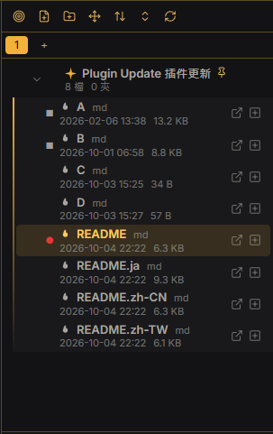
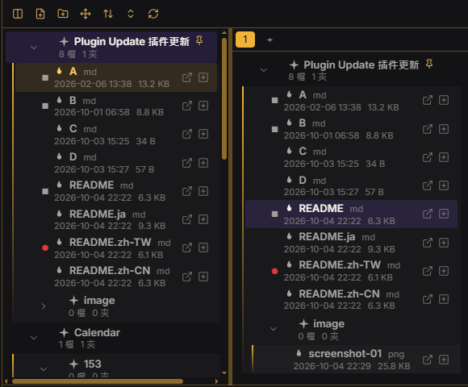
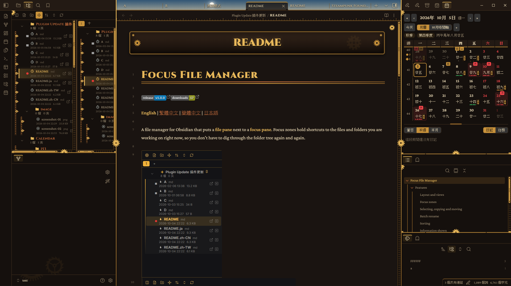
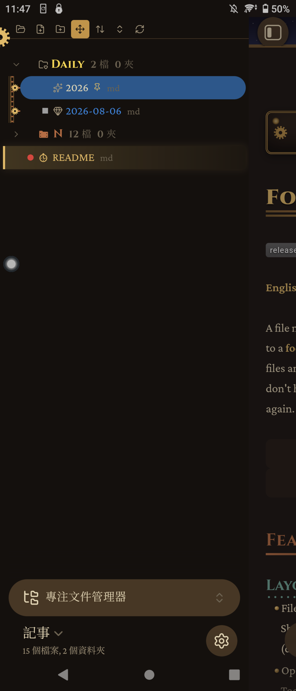
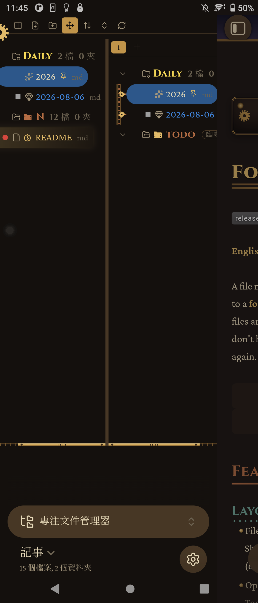

# Focus File Manager

[English](README.md) | [繁體中文](README.zh-TW.md) | **簡體中文** | [日本語](README.ja.md)

Obsidian 文件管理插件：左边是**文件管理区**，右边是**专注区**。专注区用来放当前最需要的文件和文件夹快捷方式，不必反复在文件夹树里翻找。从 2.0.0 起，左边还能切换成**标签管理**与**属性管理**，直接整理整个库的标签与属性。

  
  

  
  

## 历史更新

### 2.1.0

这个版本重做了批量重命名，新增 Vim 风格按键、右键子菜单与可移动窗口，并让设置页分成类别、不再一次渲染全部。

**批量重命名与批量创建**
- 「方案」改名为**模板**，默认不使用模板；旧方案会自动转成模板。
- 新增**编辑格式**：名称格式／编号、删除名称格式／编号、修改大小写、字符／字符串（替换、删除、移动）、名单替换。可以叠加多个步骤，按「转化」把当前设置加入待应用的步骤，按「应用」才真正改名。
- 调整参数时，下方预览会**同步更新**（尚未转化的设置也会显示，并有提示）。
- 编号可设置起始值、增减值（可递减）、补零、要跳过的编号（例如 `100 200 600 700 800 1100`）、循环跳过（`1 3 5 7`）、字母序列（`a b c`、`A B C`、`Z Y X`）、分组样式（`A1 A2 A3 B1 B2 B3`）、中文数字（`一二三`、`壹贰叁`）、时间（可用创建时间或修改时间）与文件夹名称。
- 名称格式可以放在名称的开头、结尾、第 N 个字符之前／之后／之间，也可以从结尾开始数。
- 删除格式可移除开头／结尾编号、日期、时间、括号内文字与多余空白；自定义正则和字符／字符串都有**常用格式**可以点选填入。
- 每个文件前有**勾选框**，并有全选、全不选、反选，以及输入多个字段（空格或逗号分隔）后按「确认」勾选名称包含它们的文件。
- **批量创建**改成先命名、再创建：先在预览里把名称排好，按「创建」才真正创建文件。

**粘贴、创建与移动**
- 手动排序下，选取一个文件后粘贴可以放在它的**上方或下方**；设置「粘贴时」可选下方、上方或每次询问（默认）。右键也有「粘贴到此项目之上／之下」。
- 右键新增「**在此处创建** 笔记／文件夹／Base／画布／模板日记」与「在此处批量创建…」；手动排序下对文件右键，可创建在它的上方或下方（设置「创建时」）。
- 右键「**快速往上／往下…**」：选一个目标文件夹与参考项目，把选取的项目批量移到它的上方或下方。
- 置顶的项目之间也能互相交换位置（拖动、往上／往下、粘贴都适用）。

**右键菜单**
- **子菜单**：在「右键功能管理」新增子菜单，自定义名称与图标，把功能移进去，可多层嵌套、单独启用或停用（停用后里面的功能回到原本的菜单）。鼠标停留就会展开。
- 「右键功能管理」现在会列出 **Obsidian 自带**与**其他插件添加**的项目，可排序、隐藏、换图标或收进子菜单，实际右键菜单与这份清单一致，分隔线也能正确显示。
- 每个项目多了「移到上方分隔线之后／下方分隔线之后」的快速按钮。
- 移除「右键创建其他文件类型」：其他插件（例如 Excalidraw、Templater）添加的右键项目现在会自动出现。
- 「复制完整路径」改名为「**复制设备路径**」。

**Vim 风格按键与快捷键**
- 文件管理、标签管理、属性管理可以用 Vim 风格按键操作（`j k h l`、`gg`、`G`、`5j`、`yy`、`dd`、`p` 等），可跟随 Obsidian 的 Vim 设置、一律开启或关闭；按键映射可自定义，也能读取 `.obsidian.vimrc` 里的映射。
- 新增命令：**聚焦到文件管理／聚焦到笔记编辑区／在两者之间切换焦点**，可在 Obsidian 的快捷键设置里指定快捷键。
- 设置「打开右键菜单的按键」（默认 `Alt+M`），在管理面板里为选取的项目打开右键菜单。

**其他**
- 批量重命名、批量修改 YAML 等大窗口改成**可移动的浮动窗口**，拖动标题即可，后面的笔记仍然可以阅读与操作（可在设置关闭）。
- 名称排序支持**中文数字**（`第二章` 排在 `第十章` 之前，也支持 `一百零一`、`壹贰叁`）。
- 工具栏第一行右边新增 **＋**，可把文件管理在新标签页打开。
- 设置「关闭标签页时」：返回上次使用的标签页（默认）、左边、右边，或保持 Obsidian 默认。
- 设置「最后修改时间」（默认关闭）：编辑笔记时，自动把指定属性更新为当前时间。
- 设置页分成**六个类别**，只创建当前类别，打开更快；搜索时会搜索全部类别，输入 `#` 会列出全部功能区块。

**修复**
- 修复右键「粘贴」与「在此处创建」询问上方或下方时，点了没有反应。
- 修复批量重命名格式中删掉 `{n}` 后，编号设置仍然显示。

### 2.0.0

这个版本新增了标签与属性的整理工具、批量处理，以及更多排序和菜单设置。细节都写在下方的「功能」与「操作说明」。

**新增：标签与属性管理**
- **标签管理**：列出整个库的标签，列包括编号、状态（上锁）、标签名称、标签注释、上次使用、数量。支持排序、嵌套显示、搜索、重命名、合并、删除、文件夹分类、去除重复标签，以及展开使用该标签的笔记。
- **属性管理**：列出全部属性和类型图标，列表类型可展开查看每个值。支持批量更改类型、重命名、删除、复制、添加值、创建属性与文件夹分类。
- 左侧区域可用工具栏的「标签管理」「属性管理」按钮切换，也能用面板右上角的 **＋** 或命令在**新标签页**打开（标签页版本的列宽与列格式独立保存）。
- 在列上右键可调整**靠左／居中／靠右**、自定义移动距离、自动换行，以及一次性的自动调整列宽。

**新增：批量处理**
- **批量修改 YAML**：新增、编辑、删除、排序属性，可应用到全部或部分文件；支持日期与日期＋时间类型、每个文件各自不同的值、从库中已有的值快速选取、预览（含源码对照）、保存方案。
- **批量创建**：一次创建多个笔记、文件夹、模板日记、Base、画布等，创建后自动进入批量重命名。
- **批量重命名**新增**名单替换**：粘贴或导入名称列表，按顺序应用，可存成方案。
- **根据标签移动文件**、**根据 YAML 移动文件**：用包含／排除条件筛选选取的文件，列出结果后移动到指定路径。
- 右键新增**复制名称**（可批量）。

**新增：菜单、排序与显示**
- **右键功能管理**：每个项目可开关、调整顺序、换图标，也能自行添加分隔线。
- 手动排序时，在文件夹（或根目录空白处）右键可选**排序此文件夹…**，并新增**文件夹位置**：最上方、最下方，或按名称与同名文件混合排序。
- **隐藏／排除文件**：右键隐藏或取消隐藏，工具栏的眼睛按钮切换是否显示被排除的项目。
- 在标签页上右键新增**在专注文件管理器中定位**；点击标签栏下方的文件名可定位该文件，双击则重命名。
- 笔记中的标签可设置为**单击直接编辑、双击才搜索**。
- 在设置页的搜索框输入 `#` 会列出所有功能区块，点击即可跳转。
- 启用插件时可自动在左侧栏打开。
- 「属性…」窗口每一行都有复制按钮，文字也可以直接框选复制。

**修复与调整**
- 修复：关闭「显示打开符号」后，符号仍会被强制显示。
- 移除工具栏的「刷新」按钮（打开标记会自动更新）。

### 1.0.0

首次发布：文件管理区与专注区、批量重命名、手动排序、打开标记与书签联动、主题兼容、缩进线、多语言。

## 功能

### 布局与视图
- 左边文件管理、右边专注区，可只显示其中一个或两者同时显示，中间的分隔线可拖动调整（双击还原）。
- 左边区域可在**文件管理／标签管理／属性管理**之间切换（工具栏按钮，再按一次回到文件管理）。
- 可在左侧边栏或主区域打开；启用插件时可自动在左侧栏打开（默认开启）。顶部按钮可选文字、图标、图标加文字，「文件管理／专注区／两者」也能合并成一个循环按钮。
- 两种文件管理样式：**树状**（默认，可展开文件夹）与**电脑式**（上方路径栏、上一页／下一页／上一层、可点击的路径片段、右键复制路径、鼠标前进后退键、Alt+←/→、Backspace）。专注区不受影响。
- 设置页有搜索框，输入 `#` 可列出所有功能区块并快速跳转。
- 设置页分成六个类别（常规、显示与标记、外观、右键功能管理、快捷键与 Vim、批量与模板）。上方的搜索框会搜索全部类别；输入 `#` 可列出所有功能区块并快速跳转。
- 工具栏第一行右边的 **＋** 可把文件管理在新标签页打开（已经在主区域时不显示）。

### 专注区
- 可创建多个命名的专注区（标签页），能重命名、删除、调整顺序。
- 用右键「加入专注区…」或从文件管理区拖动加入；右键或拖回文件管理区即可移除。
- 文件夹可选「包含所有子层」或「只包含当前层级」。
- **临时文件夹**：只存在于专注区里的虚拟文件夹，用来整理快捷方式，不会创建真实的文件夹。

### 选取、复制与移动
- Ctrl／Shift 多选、全选（可见项目或含未展开）、复制／剪切／粘贴（快捷键或右键），桌面版还能**跨库**，也可复制相对路径、完整路径或**名称**（可批量，一行一个）。
- 选取模式：桌面用右键「进入选取状态」；手机**向右滑**进入，之后可点选更多项目，或对下方项目再向右滑，选取两者之间的全部。
- 拖动移动。**跨层级移动**开关可把拖动限制在同一层级；关闭时，拖动期间其他层级会变灰（开关与变灰程度都可设置）。
- 双击（或 F2）重命名，双击判定时间可调整。
- **根据标签移动文件／根据 YAML 移动文件**：见下方「按标签／YAML 移动文件」。
- **粘贴位置**：手动排序下选取文件后粘贴，可放在它的上方或下方（设置「粘贴时」：下方／上方／询问），右键也有「粘贴到此项目之上／之下」。
- **快速往上／往下…**：右键选择目标文件夹与参考项目，批量移到它的上方或下方。

### 批量处理
- **批量重命名**：
  - **模板**：把一组步骤存起来，下次直接载入（默认不使用模板）。
  - **编辑格式**有五种：名称格式／编号、删除名称格式／编号、修改大小写、字符／字符串（替换、删除、移动）、名单替换。可叠加多个步骤，用 ↑↓ 调整顺序、✎ 修改、✕ 移除。
  - 名称格式标记：`{n}` 编号、`{a}`／`{A}` 字母、`{name}` 当前名称、`{i}` 顺序、`{time}` 时间、`{folder}` 文件夹名、`{ext}` 扩展名，分组用 `{n1}` `{n2}` `{a1}` `{A1}` `{a2}` `{A2}`。
  - 编号：起始值（数字、字母或中文数字）、增减值、补零、跳过的编号、循环跳过、分组大小、数字样式（自动／阿拉伯数字／一二三／壹贰叁）。时间可选现在、文件创建时间或修改时间，格式用 `YYYY MM DD HH mm ss ddd WW`。
  - 位置：替换整个名称、开头、结尾、第 N 个字符之前／之后／之间（替换该范围），可从结尾开始数。
  - 实时预览：调整参数时预览会跟着变；**转化**把当前设置加入待应用的步骤，**应用**才会真正改名。
  - **勾选**：每个文件前有勾选框，可全选、全不选、反选，或输入多个字段后按「确认」勾选名称包含它们的文件（可选匹配任一字段或同时匹配所有字段）。没勾选的文件保持原名，编号也会跳过它们。
  - 文件夹右键还能批量重命名它里面的文件；可拖动或用 ↑↓ 调整文件顺序。
- **批量创建**：在文件夹或空白处右键「批量创建…」，选择类型（笔记、文件夹、模板日记、Base、画布、Excalidraw）、数量与名称，**先在预览中命名，按「创建」才创建文件**。单次上限默认 10，可在设置中调整（最高 50）。
- **批量修改 YAML**：见下方「批量修改 YAML」。

### 标签管理（2.0.0）
- 列出全部标签，列：编号、状态、标签名称、标签注释、上次使用、数量；列宽可拖动调整，过长的文字以 … 显示。
- 第一行按钮：排序方式（标签名称 A→Z／Z→A、上次使用最新／最旧、手动排序）、显示嵌套标签、全部展开／全部折叠、搜索（搜索标签名称与注释）、去除重复标签，以及在标签页打开的 **＋**。
- **状态（上锁）**：点锁头为标签上锁（上锁后变红），上锁的标签无法重命名、删除或合并。
- **标签注释**：点注释列为标签写下说明。
- **上次使用**：标签被新加入笔记时会更新时间，以 `m`／`h`／`d`／`y`（分／时／天／年）显示，例如 `15 h`、`246 d`、`1 y`。尚未记录时，以使用该标签的笔记最近修改时间代替。
- 右键可以：创建标签、搜索（包含／排除，可累积多个条件后一次执行）、复制标签名称／复制加 # 的标签名称（可批量）、重命名（也可双击）、进入选取状态、合并标签、删除标签、上锁／解锁、创建文件夹与加入／移出文件夹、展开使用此标签的文件、往上／往下／移到上一层／移到下一层。
- **文件夹**只用来分类标签，不会改变标签本身的层级。
- 标签名称左边的 **⌄** 可展开使用这个标签的笔记，点笔记即可打开。
- **去除重复标签**：按名称相似度找出相近的标签并分组，可自行决定保留哪一个，再选择合并或删除；相似度阈值可调整。

### 属性管理（2.0.0）
- 列出全部属性，列：编号、属性类型（图标）、属性名称、数量。图标按 Obsidian 为该属性指定的类型显示（文本、列表、数字、复选框、日期、日期与时间、标签、别名）。
- 第一行按钮：排序方式（属性名称 A→Z／Z→A、手动排序）、全部展开／全部折叠、搜索、在标签页打开的 **＋**。
- 列表类型的属性可展开，列出所有值与使用次数；在值上右键可**重命名值**或**删除值**（应用到所有笔记）。
- 右键可以：属性类型（批量）、重命名（批量）、删除属性（批量）、进入选取状态、复制属性名称／复制属性类型＋名称／复制属性（含值）、添加值（列表属性，可批量）、搜索、创建属性、创建文件夹与加入／移出文件夹、往上／往下／移到上一层／移到下一层。
- 这里创建的文件夹，也会成为「批量修改 YAML」中挑选库内属性时的分类。

### 管理面板通用设置（2.0.0）
- 在标签管理与属性管理的列标题或单元格上右键 →「列格式…」：靠左／居中／靠右、自定义移动距离（px）、自动换行（名称太长时换行，而不是显示 …）、自动调整此列宽度／所有列宽度（一次性，不会持续自动调整）、重置此列格式。
- 在**新标签页**打开的面板，列宽与列格式独立保存，不会和左侧区域的互相影响。
- 可从命令面板在标签页打开，也能在左侧区域切换显示（见下方「命令」）。

### 按标签／YAML 移动文件（2.0.0）
- 先选取要处理的文件或文件夹，右键「根据标签移动文件…」或「根据 YAML 移动文件…」。
- 按标签：点标签切换「包含（绿）→ 排除（红）→ 不使用」，可选必须包含全部或任一选取的标签。
- 按 YAML：可添加多个条件（全部需同时满足），每个条件选「包含／排除」、属性，以及「有此属性」「指定的值」或（日期、日期＋时间类型）「日期范围」。
- 列出符合条件的文件（可取消勾选个别文件），输入或选择目标路径后移动；目标路径不存在时自动创建，同名文件会跳过而不覆盖。

### 排序
- 默认（Obsidian）、手动、名称 A→Z／Z→A、编辑时间新到旧／旧到新、创建时间新到旧／旧到新。
- **文件夹位置**：文件夹在最上方、文件夹在最下方，或「按名称混合」——文件与文件夹一起按名称排序，名称以某个文件名称开头的文件夹（例如 `A-image` 与 `A.md`）会排在该文件之前或之后（二选一）。
- 手动排序：往上、往下、上一层、下一层、置顶（会显示置顶符号）、拖动排序，并可重置手动排序（有确认窗口）。
- 手动排序时，在文件夹上右键（根目录则在空白处右键）「排序此文件夹…」可按名称或时间重新排列，也能选「含所有子文件夹」；结果会写入手动排序，之后仍可再手动调整。
- 名称排序支持**中文数字**（设置可关闭）：`第二章` 排在 `第十章` 之前，也支持 `一百零一`、`壹贰叁`。
- 置顶的项目之间也能互相交换位置。

### 显示信息
- 文件夹：文件数量（可指定计入的扩展名、可递归）与子文件夹数量；文件：扩展名、创建时间、大小。
- 信息可放在名称后面、下方，或分开摆放；大小格式可选自动单位或自定义单位／小数位数／进制基数。
- 鼠标悬停显示最后修改与创建时间；右键「属性…」可看大小、时间与文件夹总计，每一行右边有复制按钮，文字也能直接框选复制。
- 可选显示完整名称（是否按侧边栏宽度换行）与自定义文字大小（默认跟随 Obsidian）。

### 打开文件
- 单击打开；也可关闭，改用文件旁边的打开符号（符号是否显示完全由设置决定）。
- 可在当前标签页或新标签页打开（当前标签页旁边，或标签页末尾）。
- 右键：打开、在右侧新标签页打开、在右侧打开（分屏）、在新窗口打开与在文件夹中显示（桌面版）。打开符号的颜色与透明度可自定义。
- 可设置单击文件夹只选取，只有点箭头才展开／折叠。「全部展开／全部折叠」可合并成一个循环按钮，并有排除列表（文件夹名称或路径，可用通配符）。
- **从标签页定位**：在标签页上右键 →「在专注文件管理器中定位」，会展开并滚动到该文件并短暂高亮。也可以直接点击标签栏下方的文件名定位（会等待双击判定时间；双击则进入重命名），可在设置中关闭。
- **关闭标签页时**：可设置切换到上次使用的标签页（默认）、左边的标签页、右边的标签页，或保持 Obsidian 默认。

### 标记
- 打开标记：当前显示中的文件与后台标签页中的文件各一种，符号、图标或 emoji 与颜色都能自定义，各有重置按钮。
- 置顶标记，以及与 **Obsidian 书签联动**：可从菜单添加或移除书签，已加入书签的项目会有标记。

### 新建文件
- 右键「**在此处创建**」：笔记、文件夹、Base、画布、模板日记，以及「在此处批量创建…」。对文件夹右键是创建在它里面；手动排序下对文件右键，可创建在它的上方或下方（设置「创建时」：询问／上方／下方）。新建后可自动定位到新项目。
- 模板日记：可设置日记模板路径与文件名格式，右键一键创建。
- 其他插件添加的「新建…」右键项目（例如 Excalidraw）会自动出现在右键菜单中。
- 批量创建：见上方「批量处理」。

### 隐藏／排除文件（2.0.0）
- 右键「隐藏／取消隐藏（排除）」可把文件或文件夹加入排除列表；也能在设置中直接编辑列表（支持名称、路径与通配符）。
- 工具栏的眼睛按钮切换是否显示被排除的项目：默认隐藏，显示时被排除的项目会变淡。
- 排除只影响文件管理区，不影响专注区。

### 右键功能管理
- 设置 →「右键功能管理」：每个项目可开关、上下移动、更换图标（内置图标选择器）。菜单里的分隔线也会列在这里，可以移动或移除，也能「在下方加入分隔线」或在最后「新增分隔线」。默认全部开启，也能一键还原。
- 清单同时列出 **Obsidian 自带功能**与**由其他插件添加**的项目（会标示来源），可以排序、隐藏、换图标。其他插件的项目要在你按过一次右键后才会出现在清单里，也可以按「扫描其他插件的项目」立刻查找。实际的右键菜单按这份清单显示，两边一致。
- **子菜单**：按「新增子菜单」，自定义名称与图标，用每个项目旁的「移入子菜单…」把功能放进去。子菜单可以多层嵌套、可以单独启用或停用；停用时里面的功能会回到原本的菜单。右键时鼠标停在子菜单上就会展开（Obsidian 不支持时改为点击展开）。
- 可以关闭「显示其他插件添加的项目」。
- 这里管理的是文件与文件夹项目的右键菜单，不包含空白处与标签／属性管理的菜单。

### Vim 风格按键
- 在文件管理、标签管理与属性管理面板有焦点时，可以用 Vim 风格按键操作。设置 →「Vim 风格按键」可选：跟随 Obsidian 的 Vim 设置（默认）、一律开启、关闭。
- 默认按键：

| 按键 | 功能 |
| --- | --- |
| `j` `k` `h` `l`、方向键 | 上、下、折叠或回上层、展开或打开 |
| `gg` `G`、`3G` | 第一项、最后一项、第 3 项 |
| `Ctrl+d` `Ctrl+u` | 往下、往上半页 |
| `Enter` `t` `s` | 打开、在新标签页打开、在右侧打开 |
| `zo` `zc` `zR` `zM` | 展开、折叠、全部展开、全部折叠 |
| `v` `V` `Space` `Esc` | 可视模式（扩展选取）、全选、标记或取消标记当前项目、取消 |
| `yy` `dd` `p` `P` | 复制、剪切、粘贴（手动排序下为粘贴在下方）、粘贴在上方 |
| `D` `r` `a` `A` | 删除、重命名、新建笔记、新建文件夹 |
| `J` `K` | 手动排序往下、往上移 |
| `yp` `yn` | 复制路径、复制名称 |
| `m` `L` `/` | 合并标签、上锁或解锁、搜索（标签管理） |
| `Ctrl+w w` | 回到笔记编辑区 |
| `.` | 打开右键菜单 |
| `?` | 显示按键说明 |

- 命令前面可以加数字（`5j`、`3dd`），`gg`、`dd` 这类按键要依次输入（等待时间可调整）。在输入框里打字时不会被拦截；没有对应的按键（例如 `Ctrl+C`）照常使用。
- **自定义**：设置页有「按键映射表」，每一行是「按键」加「动作」，可以新增、移除或还原默认。按键可以写 `j`、`gg`，或 `<CR>`、`<Esc>`、`<Space>`、`<C-d>` 这类特殊键。
- 也可以读取 `.obsidian.vimrc`（例如 Vimrc Support 使用的文件）：支持 `nmap`、`nnoremap`、`map`、`noremap`、`unmap` 与 `let mapleader`，只使用「按键映射按键」的设置；`:` 开头的命令与 `<Plug>` 会略过。
- **在笔记与文件管理之间切换焦点**：用命令「聚焦到文件管理」「聚焦到笔记编辑区」「在笔记与文件管理之间切换焦点」，到 Obsidian 的快捷键设置指定快捷键，就不必再用鼠标点一下。
- **打开右键菜单的按键**（默认 `Alt+M`，不需开启 Vim 也能用）：在三个管理面板里，为选取的项目打开右键菜单；可以改成 `Ctrl+Shift+K` 之类的写法，留空代表不使用。

### 窗口与性能
- **可移动的窗口**：批量重命名、批量创建、批量修改 YAML、按标签／YAML 移动文件、快速往上／往下等大窗口会变成浮动窗口，拖动标题移动，后面的笔记仍然可以阅读与操作；可在设置关闭，手机版维持一般窗口。
- **最后修改时间**（设置，默认关闭）：编辑笔记并停止输入几秒后，把你指定的属性（默认 `updated`）更新成当前时间，格式可自定义（Moment.js 格式，例如 `YYYY-MM-DD HH:mm:ss`）。只更新你正在编辑的那一篇。
- 设置页分成类别，只创建当前类别的项目，打开更快。

### 外观与主题
- 使用 Obsidian 原生的样式类，主题与 CSS 片段可直接应用（已对照 Rathgar Gold 主题的 CSS 调整），并会检测主题是否自己画了图标与箭头，避免重复。
- 展开符号、文件夹与文件图标（可按扩展名）都能换成图标名称或 emoji，内置图标选择器有分类、「全部」与搜索。
- 每个项目可设图标、文字颜色、背景颜色与背景透明度，并可**保存多个外观模板**。
- 缩进线：开关、颜色、透明度、粗细、线型、缩进距离、内置模板、自定义 CSS 声明，可导出／导入到指定路径。

### 语言
- 内置 English、繁體中文、简体中文、日本語（日文与简体中文为机器翻译，可能不准）。默认跟随系统语言，找不到时用英文。
- 可导出英文模板 JSON，翻译后再导入；导入的语言以文件名显示，也能再移除。

## 操作说明

### 打开标签管理／属性管理
1. 工具栏上，「文件管理」等视图按钮的右边有「标签管理」「属性管理」两个按钮，点一下切换左侧区域，再点一次回到文件管理。
2. 想放在独立的标签页：点面板第一行最右边的 **＋**，或用命令面板的「在标签页打开标签管理／属性管理」。
3. 也可以用命令切换左侧显示：「在左侧区域显示标签管理／属性管理／文件管理」。

### 整理标签
1. **重命名**：双击标签名称（或选取后按 F2），改完按 Enter。重命名上层标签时，下面的嵌套标签会一起改（例如 `project` → `proj`，`project/alpha` 变成 `proj/alpha`）。
2. **合并**：选取标签 → 右键「合并标签…」。在「合并后的标签名称」输入现有标签＝并入该标签，输入新名称＝改名后合并；再选择笔记中被合并的标签要「替换成新的标签名称」「全部删除」或「只删除 #（保留文字）」。
3. **删除**：右键「删除标签…」，选「全部删除」或「只删除 #（保留文字）」。
4. **搜索**：右键「搜索（包含）／搜索（排除）」会跳到 Obsidian 内置搜索；想组合多个条件，先用「加入搜索条件（包含／排除）」累积，再按「执行搜索」，会组成类似 `tag:#a -tag:#b` 的查询。
5. **复制**：选取后按 `Ctrl+C` 复制标签名称，`Ctrl+Shift+C` 复制加 # 的标签名称。
6. **去除重复标签**：按第一行的「去除重复标签」，调整相似度阈值，每组选一个要保留的标签，再按「合并」或「删除」。
7. 上锁的标签不会被上面这些操作改动；如果某个标签下面的嵌套标签有上锁，也一样会被拦下。

### 整理属性
1. 选取属性（`Ctrl`／`Shift` 多选，或右键「进入选取状态」）→ 右键，即可批量更改类型、重命名、删除、复制、添加值。
2. 展开列表类型的属性，在单个值上右键可重命名或删除（会更新所有笔记）。
3. 「创建属性」可预先创建属性并指定类型；「创建文件夹」把属性分类，之后在「批量修改 YAML」就能按文件夹筛选。
4. 属性类型图标按 Obsidian 的类型设置显示；从这里更改类型后会立即更新。

### 批量修改 YAML
1. 选取文件（或文件夹）→ 右键「批量修改 YAML…」。
2. 上方切换「新增属性／编辑属性／删除属性／排序属性」，并选择应用范围：全部选取的文件，或只应用到部分文件。
3. **新增属性**：属性名称可一行一个，也可以写成 `名称=值` 直接指定值；选择值的类型（自动判断、文本、列表、数字、复选框、日期、日期与时间，日期类型有「今天」「现在」快速填入），并决定属性已存在时要跳过、覆盖或合并为列表。
4. **值应用范围**：「跟随应用范围」只需输入一次；「独立输入每个值」可让每个文件各有不同的值，用每行一个值（按文件顺序）填写，或在每个文件的框里分别填写或选取；留空代表不处理该文件。
5. 快速选取已有的值只提供给**列表类型与 tags（标签）**属性：输入时会出现建议，也可从现有值的标签直接点选。
6. 「库中其他文件使用的属性」可按属性管理创建的文件夹分类筛选，也可选「未分类」（尚未放进任何文件夹的属性）。
7. **排序属性**：选「自订顺序」时，拖动属性（或按 ↑↓）排出想要的顺序。
8. 设置好后按「转换」，操作会先放进「待应用的操作」队列（可修改 ✎ 或移除 ✕）。右侧可看预览或源码对照，也能只显示有变更的文件。确认后再按「应用」才会真的写入文件。
9. 常用的操作组合可「保存为方案」，之后直接加载；含「独立输入」的操作不会存进方案。

### 按标签／YAML 移动文件
1. 选取要处理的文件或文件夹 → 右键「根据标签移动文件…」或「根据 YAML 移动文件…」。
2. 设置包含／排除条件，下方实时列出符合的文件，可取消勾选不想移动的。
3. 输入或选择目标路径（输入时会出现建议），按「移动」。

### 自定义右键菜单
1. 设置 →「右键功能管理」。
2. 每一行：开关、更换图标、移入子菜单、移到分隔线之后、在下方加入分隔线、上移／下移。分隔线也各占一行，可以移动或移除；想要没有分隔线的菜单，把它们全部移除即可。
3. 按「新增子菜单」创建子菜单（名称、图标可改），再用每个项目旁的「移入子菜单…」把功能放进去；子菜单里的项目会缩进显示。子菜单的开关关闭时，里面的功能会回到原本的菜单。
4. 其他插件与 Obsidian 自己添加的项目也在这份清单里，标有来源，同样可以隐藏、排序或收进子菜单。
5. 「还原默认顺序与开关」会一并清除自定义图标、分隔线与子菜单。

### 批量重命名
1. 选取文件（或文件夹）→ 右键「批量重命名…」。
2. 在「编辑格式」选一种操作，填好设置；下方预览会同步显示结果。
3. 按「转化」把这个设置加入待应用的步骤，需要时再加入下一个步骤（例如先「删除名称格式」移除旧编号，再用「名称格式／编号」加新编号）。
4. 用每行前面的勾选框，或上方的全选／全不选／反选与关键字，决定这次要修改哪些文件。
5. 结果没问题后按「应用」。常用的步骤组合可按「保存为模板」，之后在最上面的「模板」菜单载入。

### 调整列
- 在标签管理／属性管理的标题或单元格上右键 →「列格式…」。
- 列标题之间的分隔线可以拖动调整宽度。

## 命令

| 命令 | 说明 |
| --- | --- |
| 在侧边栏打开专注文件管理器 | 在侧边栏打开 |
| 在主区域打开专注文件管理器 | 在主区域打开 |
| 只显示文件管理／只显示专注区／两者／循环切换 | 切换布局（默认没有快捷键，可自行设置） |
| 在左侧区域显示文件管理／标签管理／属性管理 | 切换左侧区域的内容 |
| 在标签页打开标签管理／属性管理 | 在新标签页打开管理面板（已打开时会切到该标签页） |
| 聚焦到文件管理／聚焦到笔记编辑区 | 把焦点移到文件管理，或回到最近使用的笔记（默认没有快捷键，可自行设置） |
| 在笔记与文件管理之间切换焦点 | 一个快捷键来回切换 |

## 安装

**手动：** 从最新的 [release](../../releases) 下载 `main.js`、`manifest.json`、`styles.css`，放进 `<库>/.obsidian/plugins/focus-file-manager/`，再到设置启用插件。

**BRAT：** 在 BRAT 插件中添加本仓库地址。

从侧边的 ribbon 图标或命令面板（「在侧边栏／主区域打开专注文件管理器」）打开。

## 声明

- **没有任何网络请求、没有遥测、不收费。**
- 只有在你主动操作时才会碰到库以外的文件：跨库复制／剪切／粘贴（使用系统剪贴板，以及操作系统临时文件夹里的小文件 `obsidian-ffm-clipboard.json`）、把样式或语言文件导出／导入到绝对路径，以及「在文件夹中显示」。
- **标签、属性、YAML 与移动文件的批量操作会直接修改你的笔记。** 操作前建议先备份库，大量改动前先用预览确认。
  - 标签重命名、合并、删除会修改笔记正文中的 `#标签` 与 frontmatter 的 `tags`（frontmatter 标签会改写成列表格式）；代码块内的 `#文字` 不是标签，不会被改动。
  - 批量修改 YAML 与属性的重命名／删除／添加值，是通过 Obsidian 的 frontmatter 接口写入，YAML 内的注释与原本的排版可能被整理掉。
  - 标签的注释、上锁、文件夹与「上次使用」只存在于插件设置中，不会写进笔记。
- 用到少数 Obsidian 未公开的内部接口（核心书签插件、快捷键设置页、核心搜索插件、属性类型设置），可能随 Obsidian 版本变动；其中属性类型相关功能若 Obsidian 版本不支持，会显示提示。
- 手机版仍属实验性质：跨库功能只有桌面版，触摸屏不支持拖放。
- 为了列出其他插件添加到右键菜单的项目，插件会在你按右键时调用它们注册的文件菜单处理函数，只读取它们要添加的项目；这些项目被点击时才会执行该插件原本的功能。
- 「最后修改时间」（默认关闭）启用后，会在你编辑的笔记 frontmatter 写入一个属性。
- 新用到的 Obsidian 未公开接口：文件菜单的事件处理函数清单、标签页关闭。可能随 Obsidian 版本变动。

## 问题反馈与建议

如果遇到问题或有任何建议，欢迎到 GitHub 项目中[提交 Issues](https://github.com/yuri55448/Focus-File-Manager/issues)。反馈时如果能附上 Obsidian 版本、插件版本、使用的主题与复现步骤（或截图），会更容易处理。
